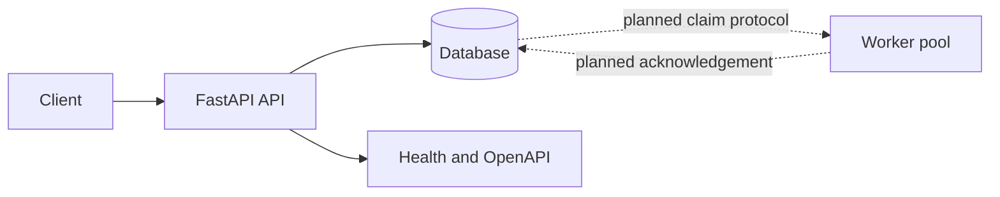

# Architecture

## Current implementation

FluxQueue is currently an API-first foundation. FastAPI validates job requests; SQLAlchemy persists job records. SQLite is the default local smoke-test database and Docker Compose configures PostgreSQL.

Implemented routes: enqueue, list/filter/paginate, retrieve by ID, cancel queued/retry-wait jobs, queue counts, liveness, readiness.

## Target job lifecycle

`queued -> running -> succeeded`

A retryable failure should transition through `retry_wait`; exhausted or permanent failures should transition to `dead`. A queued job can be cancelled. These target states are represented by the model, but worker execution, retries, leases, lease fencing, and scheduler promotion have not been implemented yet.

## Reliability requirements for the worker milestone

- Claim eligible jobs in a short database transaction using a safe concurrent-claim pattern.
- Execute handlers outside the transaction.
- Renew leases with a heartbeat and only acknowledge using the current lease generation/token.
- Reclaim expired leases and prevent stale workers from overwriting newer state.
- Use bounded exponential retry backoff with jitter.
- Keep user payloads as validated data; dispatch only registered task handler names.
- Test concurrent duplicate submissions and database failure behavior.

## Migration and deployment boundary

Startup currently calls SQLAlchemy `create_all` to keep the first milestone easy to run. This is not a substitute for Alembic migrations. The API has no authentication yet and must not be exposed as a public service.
