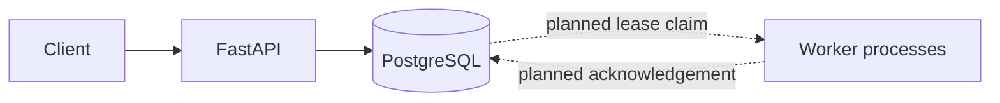

# Architecture

## Current foundation

A FastAPI service with SQLAlchemy stores job records. The database is the source of truth. The API accepts JSON payloads and stores named task types; it does not execute submitted code.

Current endpoints support enqueue, retrieval, filtering, queue counts, health checks, and cancelling queued jobs. Worker claiming, leases/fencing, scheduling, retries, and the dashboard are not yet implemented.

SQLite is useful for local smoke tests; PostgreSQL is the intended concurrency database. Startup schema creation is a temporary convenience; Alembic migrations are required before production use.
