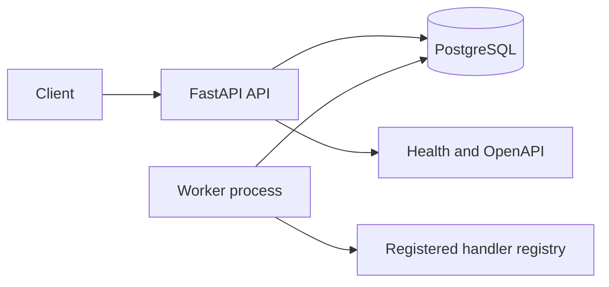

# Architecture

## Current implementation

FluxQueue is a FastAPI API plus a separate polling worker. SQLAlchemy persists jobs in PostgreSQL (the Docker Compose default). SQLite remains useful for isolated local tests.

The API supports enqueue, retrieval, filtering, pagination, queue counts, cancellation of queued/retry-wait jobs, liveness, and readiness. The worker currently registers `echo`, `add_numbers`, and `uppercase`; unknown task names fail through the retry/dead-letter lifecycle rather than being dynamically imported or executed.

## Claim and lease protocol

The worker selects the highest-priority eligible job and locks the selected row with `FOR UPDATE SKIP LOCKED` on databases that support it. It changes the state to `running`, increments the attempt count, and assigns a random lease token and expiry in a short transaction. The handler runs outside that transaction.

A heartbeat renews the lease only while the same token owns a running job. Success and failure updates also require the current token, fencing out stale workers after a lease is reclaimed. Expired running leases can be reclaimed; a crashed job that has already consumed all attempts becomes `dead`.

## Retry behavior

Failures are stored as bounded error text. Jobs below their attempt limit transition to `retry_wait` with bounded exponential backoff and jitter. Exhausted jobs transition to `dead`. Side-effecting handlers must remain idempotent because a worker can complete an external side effect and crash before persisting success.

## Migrations and deployment

Alembic applies the initial worker lease migration. The migration can add lease/scheduling fields to an existing `jobs` table and creates the full current schema for a fresh database. Docker Compose starts PostgreSQL, runs migrations before API startup, and starts the worker after API readiness.

A shared bearer API key protects job/queue routes when configured, and production settings fail closed without one. Tenant authorization, per-user identities, request/payload limits, and full public deployment hardening are still missing. The current API must not be exposed publicly until those are addressed.
